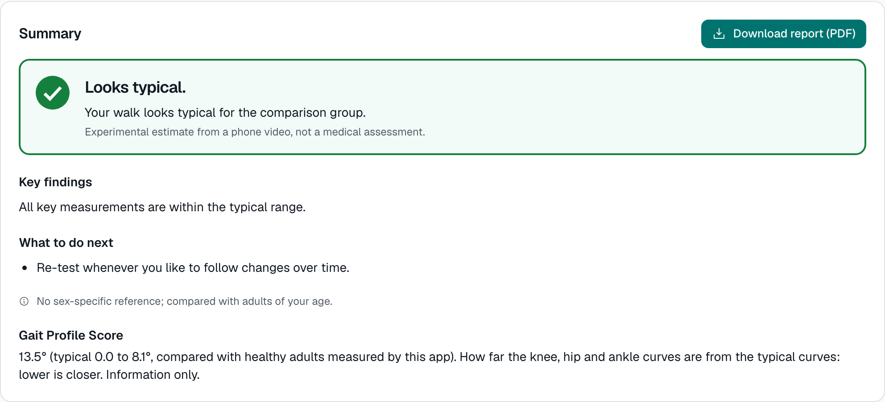
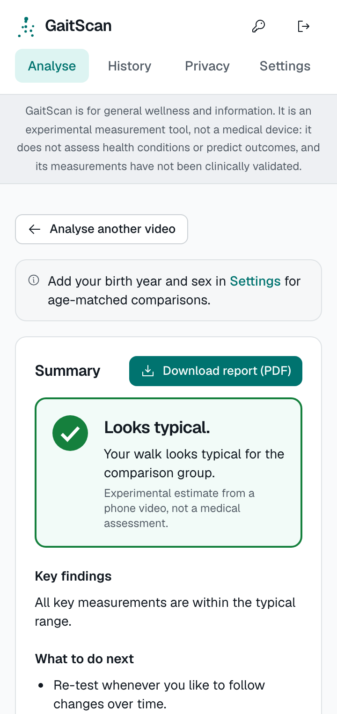
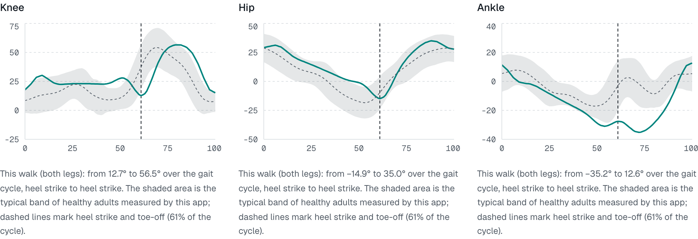
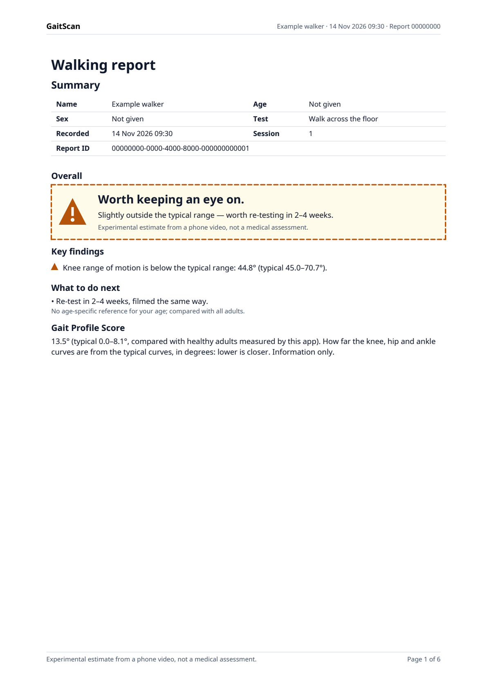

# GaitScan — Frontend

[](https://github.com/KanveerMadan/gaitscan-frontend/actions/workflows/ci.yml)


The web app for GaitScan: film yourself walking side-on and get your cadence, step time and a gait
profile (timing, knee, hip and ankle movement), each compared with healthy adults, with an overall
summary and a PDF report. The API and the measurement pipeline are in the
[backend repository](https://github.com/KanveerMadan/GaitScan).

> **Not a medical device.** GaitScan is for general wellness and information. It is an experimental
> measurement tool: it does not assess health conditions or predict outcomes, and its measurements have
> not been clinically validated.

**Live app:** https://gaitscan-frontend-mnt9.vercel.app · **Example result, no account:**
https://gaitscan-frontend-mnt9.vercel.app/demo

## Screenshots

Made with Playwright from the end-to-end tests' mock data (the backend's output for its simulated
walker; no real user data), at 2× (`README_SHOTS=1 npx playwright test e2e/readme-screenshots.spec.ts`).
The PDF page is rendered by the backend's `tools/readme_pdf_page.py`.

| Result summary                                                                                                                               | Phone (360 px)                                                                                  |
| -------------------------------------------------------------------------------------------------------------------------------------------- | ----------------------------------------------------------------------------------------------- |
|  |  |





## What it does

- **Upload and results.**
  - Upload a walking video, or record one in the browser; the analysis runs on the server and the
    app polls until it's done, with an optional "notify me when it's done".
  - **Result page** (pipeline 3.0.0 on), in four sections:
    - **Summary:** the overall verdict as an icon, words and border style ("Looks typical", "Worth
      keeping an eye on", "Outside the typical range"), the key findings, what to do next, recording
      tips when there's no verdict, the Gait Profile Score, and **Download report (PDF)** in English or
      Hindi.
    - **Timing and rhythm:** cadence, step time, step-time variability, stance, swing and double
      support. Each has a level (a shape plus a word, never colour alone), the typical range, the error
      range, data confidence and "what this means".
    - **Joint movement:**
      - knee, hip and ankle curves over the gait cycle on the typical band of healthy adults measured
        by the app, with heel-strike and toe-off markers, a hover readout and a text summary per chart;
      - key events, ranges of motion, trunk lean and arm swing;
      - skeleton snapshots drawn from pose points (no video frames are kept).
    - **Recording quality and data confidence:** collapsible, and open when there's no verdict.
  - The verdict and its wording come from the API in English and Hindi, in general-wellness language:
    it says what to do next, never what is wrong.
  - Values are for both legs together. Left/right values, symmetry and pelvis movement aren't shown:
    in a side view the app can't reliably tell the legs apart, and pelvis movement read about twice
    published values. Arm swing is information only: against an arm-worn sensor it read about 5° high on
    average (mean difference 8°).
  - When a measure has too little data the page says "Not enough data". Results from before 3.0.0 keep
    the earlier page: cadence and step time with error ranges.
  - A treadmill test at an entered belt speed (not yet validated).
  - A gentle prompt to add birth year and sex in Settings for age-matched comparisons; both stay
    optional.
- **Turned-down videos** come with the reason and what to change.
- **Before filming:** a setup check (live framing guidance in the browser), a first-test walkthrough,
  an example result (`/demo`) and Learn pages for each measurement (`/learn`).
- **Your sessions:**
  - History rows show the verdict and the key numbers, with search and tag filters, and session notes
    and tags.
  - **Progress** across tests with a gait profile:
    - cadence (with your goal), step-time variability, knee and hip range, and the Gait Profile Score;
    - "change since last test", where changes within the error range show as no change.
  - A cadence goal, re-test reminders as a calendar file, and a "next walking test" card.
  - Ghost replay (two sessions' averaged strides, one over the other), and comparing two sessions.
  - The PDF report: summary, timing, joint movement, progress, and recording quality and method.
- **Accounts and privacy:**
  - Consent before the first analysis.
  - Privacy center: export, delete sessions, delete the account, and how long each kind of data is kept.
  - Recovery codes, change password, Sign in with Google (when configured).
  - Password reset and email verification pages (unused until the backend sends email).
  - Other adults on one account (profiles), each with their own history.
  - Settings: units, theme, language (English, Hindi draft), reminders, and optional sex and birth year.
  - Read-only share links for one session (compared with all adults, so no age or sex is shown).
- **Clinicians** see the sessions of patients who linked to them with an invite code, in an inbox
  that marks what's new. They open a patient's session (every section and the report) from the
  patient list, and can comment on a session with the patient.

## Stack

React 19, Vite 8, React Router 7, Tailwind v4 with owned shadcn/ui primitives (Radix), Phosphor
icons, Geist, Recharts, Axios, optional Sentry. The API client is typed from the backend's OpenAPI
contract.

## Local setup

Node 22.13+.

```bash
npm ci
cp .env.example .env.local      # VITE_API_BASE_URL=http://localhost:8000 for a local backend
npm run dev                     # http://localhost:3000
```

| Script                                  | What it does                                                                                                                                               |
| --------------------------------------- | ---------------------------------------------------------------------------------------------------------------------------------------------------------- |
| `npm test`                              | Vitest (unit and screen tests, API mocked)                                                                                                                 |
| `npm run e2e`                           | Playwright on the production build, API mocked at the network layer: the main flow, phone-width layout, and axe (WCAG 2.1 AA) scans in light and dark mode |
| `npm run lint` / `npm run format:check` | ESLint / Prettier                                                                                                                                          |
| `npm run typecheck`                     | `tsc --noEmit`                                                                                                                                             |
| `npm run gen:api`                       | Regenerate `src/api/schema.d.ts` from `contracts/openapi.json`                                                                                             |
| `npm run build`                         | Production build into `dist/` (needs `VITE_API_BASE_URL`)                                                                                                  |

**API contract.** `contracts/openapi.json` is a byte-identical copy of the backend's. When the API
changes, copy the new file over, run `npm run gen:api` and commit both; CI fails if they drift.

Pre-commit hooks (ESLint, Prettier): `pre-commit install` (git ≥ 2.35).

## Layout

| Path                              | What                                                                                 |
| --------------------------------- | ------------------------------------------------------------------------------------ |
| `src/App.jsx`                     | Routes; screens other than sign-in and upload load on demand                         |
| `src/screens/`                    | One file per screen (landing, analyse, history, session, compare, privacy, learn, …) |
| `src/measurements.jsx`            | Earlier results' tables: values, error ranges, "not yet validated" labels            |
| `src/components/gait-profile.jsx` | The v3 result page: summary, timing, joint charts, snapshots, quality                |
| `src/components/progress.jsx`     | Progress across tests (`GET /me/trends`)                                             |
| `src/components/ui/`              | The design system's primitives (owned shadcn/ui)                                     |
| `src/api/`                        | Typed client and generated schema                                                    |
| `src/i18n/`                       | Interface text: `en.js`, and `hi.js` (draft, under review)                           |
| `e2e/`                            | Playwright specs (and the README screenshots, on request)                            |
| `docs/images/`                    | README screenshots                                                                   |

## Configuration and deployment

- **Configuration.** See [.env.example](.env.example). Only `VITE_*` variables reach the browser;
  never put secrets there.
- **Deployment.** Vercel (Vite preset, output `dist`). Set `VITE_API_BASE_URL` (and optionally
  `VITE_SENTRY_DSN`) for Production and Preview. The backend's `CORS_ORIGINS` must list the deployed
  origin, and its `FRONTEND_URL` must point here for links in emails.

## License

[MIT](LICENSE). The licence covers this code only. GaitScan is not a medical device, and its
measurements have not been clinically validated.

Third-party material keeps its own terms: the cadence reference is from Mobbs et al. 2025 (_Sensors_
25(2):581, CC BY 4.0), the other references are from healthy adults of the LJMU dataset (Topham et al.
2023, CC BY 4.0) measured by the app; the icons are Phosphor (MIT).

## More

- [Contributing](CONTRIBUTING.md) · [Code of conduct](CODE_OF_CONDUCT.md) · [Security](SECURITY.md)
- [Changelog](CHANGELOG.md)
- Architecture, model card, verdicts and validation: in the [backend repository](https://github.com/KanveerMadan/GaitScan/tree/main/docs)
